# Verifying and Merging Sparkrun Recipes

## Overview

A recipe is **Verified** only when the model boots and answers a real HTTP request on the target cluster with shard-complete weights. Merging an external recipe set into `sparkrun-recipes` (`spark-forge` registry) requires deduplicating by checkpoint + route, normalizing YAML fields to `spark-forge` cluster contracts, and updating registry state.

**Violating the letter of the rules is violating the spirit of the rules.**

## The Iron Laws

```
1. NO "VERIFIED" STATUS WITHOUT A LIVE COMPLETION RESPONSE ON THIS CLUSTER
2. NO LAUNCH OR SYNC OVER MANAGEMENT LAN (10.10.20.11) — ALWAYS USE CX7 (10.99.10.11 / 10.99.11.11)
3. NO DUPLICATE RECIPES FOR THE SAME CHECKPOINT + PARALLELISM ROUTE
```

Passing `sparkrun recipe validate` or `--dry-run` proves only that the YAML **Lints**. Never use the word `Validated` as a status (it conflates linting with serving).

## When to Use

```dot
digraph recipe_flow {
    rankdir=LR;
    start [label="New / External\nRecipe YAML", shape=box];
    dedup [label="Same checkpoint +\nroute in recipes/?", shape=diamond];
    merge_hdr [label="Keep canonical file;\nmerge evidence to\nbenchmarks/ & header", shape=box];
    norm [label="Normalize YAML to\nspark-forge contract", shape=box];
    shards [label="All shards complete on\ntarget nodes + hardlinked?", shape=diamond];
    stage [label="Resume hf download +\nHardlink Xet blobs +\nrsync over CX7 10.99.10.11", shape=box];
    cotenant [label="Node RAM free for\ngpu_memory_utilization?", shape=diamond];
    wait_win [label="Hold launch (or stage as\n# >>> UNBENCHMARKED only\nif operator requests)", shape=box];
    boot [label="Dry-run -> Launch --no-follow\n-> Probe /v1/models & chat", shape=box];
    record [label="Record in header, INDEX.md,\nMODELS.md, HISTORY.md +\nregistry update + NAS backup", shape=box, style=filled, fillcolor="#ccffcc"];

    start -> dedup;
    dedup -> merge_hdr [label="yes"];
    dedup -> norm [label="no"];
    norm -> shards;
    shards -> stage [label="no"];
    stage -> shards;
    shards -> cotenant [label="yes"];
    cotenant -> wait_win [label="no"];
    cotenant -> boot [label="yes"];
    boot -> record [label="answers request"];
}
```



- Importing or merging recipes from external directories (`~/workspace/miaai-runner`, `~/.config/sparkrun/recipes/miaai-lab`, upstream registries) into `~/workspace/sparkrun-recipes`
- Preparing, repairing, or verifying any `tp1`, `tp2`, or `ep2` recipe on `dgx-pair`, `dgx-pair-ep`, `gb10-solo`, or `gx10-solo`
- Auditing whether a Hugging Face checkpoint in `~/.cache/huggingface/hub` is launchable across `gb10-spark` and `gx10-spark`

## Quick Reference

| Check / Parameter | Required `spark-forge` Standard | Forbidden / Broken |
|---|---|---|
| **Status Bar** | `Lints` -> `Serves` -> `Verified` -> `Benchmarked` (or `Unfit` / `UNBENCHMARKED`) | `Validated`, `VERIFIED (dry-run)`, `Tested` |
| **Filename** | `<model>-<abliterated\|uncensored>-<quant>-<tp1\|tp2\|ep2>.yaml` matching rank count | Keeping `-tp1.yaml` when `tensor_parallel: 2`; overwriting stock with abliterated |
| **Default Port** | `port: 8000` (`8001` co-locate, `8101` refusal-dial) | `port: 8888` (harness-only port) |
| **GPU Memory Util** | `0.70–0.82` (or explicit `--kv-cache-memory-bytes` pin) | `0.85+` unpinned (triggers NVRM/earlyoom OOM on 121 GiB GB10) |
| **Cluster Comm Env** | Inherited from `~/.config/sparkrun/clusters/dgx-pair.yaml` (`f1` ports) | Any `NCCL_IB_HCA`, `NCCL_SOCKET_IFNAME`, `GLOO_*`, `TP_*` in recipe `env:` |
| **Worker Node Address** | CX7 200GbE data plane: `10.99.10.11` or `10.99.11.11` | Management LAN `10.10.20.11` (`enP7s7` drops carrier / 1GbE) |
| **Shard Audit** | Check `*index.json` (`model` + `consolidated`), `MANIFEST.json`, `.incomplete`, `blobs/` symlinks | `ls` or `du -sh` on `models--*` (fooled by 36 KB stubs & Xet symlinks) |
| **Xet Blobs** | Hardlink `models--*/blobs/*` before `sparkrun` or `rsync` | Leaving relative symlinks (unlinked by `sparkrun 0.3.10` self-rsync `rc=24`) |

## Required Contract: Normalized `spark-forge` Recipe YAML

Every recipe committed to `~/workspace/sparkrun-recipes/recipes/<name>.yaml` MUST contain these sections in order:

1. **Evidence Header Block (`# >>> ...`):**
   - Top of file: `# >>> VERIFIED <YYYY-MM-DD> on <cluster>` (or `# >>> UNFIT <date>` / `# >>> UNBENCHMARKED — <reason>`) recording measured `max_model_len` from `/v1/models`, boot time, per-rank GiB, single-stream and 8-way tok/s, and required mods/caveats.
   - If the cluster is occupied or weights are incomplete, **do not commit as `VERIFIED`**. Wait for a clean window (or, only if the operator explicitly asks to stage the file early, mark `# >>> UNBENCHMARKED — <missing shards/window>` in the header and `UNBENCHMARKED` in `INDEX.md`).
2. **Core Identity & Placement:**
   - `recipe_version: "2"`, `model: <org>/<repo>`, `runtime: vllm | sglang | atlas`, immutable `container:` tag (never `:latest`, never digest `@sha256:` which fails on the worker in sparkrun 0.3.10), `min_nodes` and `max_nodes` (max `2`; drop any recipe requiring 3+ nodes).
   - Filename suffix (`-tp1`, `-tp2`, `-ep2`) MUST match `defaults.tensor_parallel` / `expert_parallel` (never keep a `-tp1.yaml` filename after patching to `tensor_parallel: 2`).
   - Abliterated checkpoints MUST include `-abliterated-` or `-uncensored-` in the filename so they never overwrite stock recipes.
3. **Required GB10 Mods & Executor Config:**
   - `executor_config: {entrypoint: ""}` whenever the container image bakes `ENTRYPOINT ["vllm", "serve"]`. Omit `user: root` unless required by container paths so root does not corrupt `~/.cache/huggingface/hub` ownership.
   - Include required SM121 kernel mods under `mods:` (e.g., `mods/glm53-sm121-topk` for NVFP4 GLM-5.3, `mods/glm53-exl3-gb10-topk` for EXL3 GLM-5.3 to prevent the `persistent_topk` crash at ~32k decode).
4. **Environment (`env:`) — NO Cluster Comm Pins:**
   - **NEVER** put `NCCL_IB_HCA`, `NCCL_SOCKET_IFNAME`, `GLOO_SOCKET_IFNAME`, or `TP_SOCKET_IFNAME` in a recipe `env:`. Those live exclusively in `~/.config/sparkrun/clusters/dgx-pair.yaml` (pinned to the `f1` ports).
   - For `b12x` Qwen3.8 Flash-Next on rootless Docker, include `VLLM_PLE_TABLE_MEMORY: "ram"` (avoids `io_uring` seccomp failure) and `VLLM_ENABLE_ROCE_ALLREDUCE: "0"`.
5. **Defaults (`defaults:`):**
   - `port: 8000` (always normalize harness ports like `8888` to `8000`, except deliberate co-location profiles on `8001` or refusal-dial on `8101`).
   - `gpu_memory_utilization`: **`0.70–0.82`** (`0.85+` triggers NVRM/earlyoom OOM on 121 GiB GB10 unified memory unless KV memory is explicitly bounded with `--kv-cache-memory` / `--kv-cache-memory-bytes`).

```yaml
# >>> VERIFIED 2026-10-29 on dgx-pair: max_model_len 850000, ready in 361-466s, 13.5 tok/s c=1.
# >>> REQUIRES mods/glm53-exl3-gb10-topk (disables GB10 persistent_topk crash at ~32k decode).
recipe_version: "2"
model: bullerwins/GLM-5.3-Flash-exl3-4bpw-ablit
runtime: vllm
container: ghcr.io/miaai-lab/glm-5.3-flash-2x-dgx-sparks:exl3
min_nodes: 2
max_nodes: 2

mods:
  - mods/glm53-exl3-gb10-topk

executor_config:
  entrypoint: ""
  shm_size: 32gb

readiness:
  port_timeout_s: 3600
  health_timeout_s: 3600
  inference_timeout_s: 600

env:
  GLM53_MODEL_PRESET: "abliterated"
  ABLIT: "0"
  GLM53_INDEXER_WORKSPACE: "rightsize"

defaults:
  port: 8000
  tensor_parallel: 2
  gpu_memory_utilization: 0.80
  max_model_len: 850000
  kv_cache_dtype: fp8
  kv_cache_memory_bytes: 15032385536
  quantization: exl3
  distributed_executor_backend: mp
  served_model_name: bullerwins/GLM-5.3-Flash-exl3-4bpw-ablit
```

## Step-by-Step Verification & Merge Workflow

### 1. Pre-Flight Shard, Hardlink & Drafter Audit (Both Nodes via CX7 `10.99.10.11`)

Never use `ls` or `du -sh` on `~/.cache/huggingface/hub/models--*` (which hides 36 KB config stubs, `.incomplete` partials, and symlinked blobs). Run this check across **all three** index formats (`*index.json` including `model.safetensors.index.json` and `consolidated.safetensors.index.json`, `MANIFEST.json`, and single-shard weight files) on both `gb10-spark` and `gx10-spark` (`10.99.10.11`):

```bash
rtk python3 - << 'EOF'
import json, subprocess

AUDIT = r"""
import os, glob, json
hub = os.path.expanduser("~/.cache/huggingface/hub")
WEXT = (".safetensors", ".gguf", ".bin", ".pt", ".pth", ".exl3")
out = {}
for d in sorted(glob.glob(os.path.join(hub, "models--*"))):
    name = os.path.basename(d)[len("models--"):].replace("--", "/")
    blobs_dir = os.path.join(d, "blobs")
    symlinks = [f for f in glob.glob(os.path.join(blobs_dir, "*")) if os.path.islink(f)]
    incompletes = glob.glob(os.path.join(blobs_dir, "*.incomplete"))
    best = {"status": "EMPTY", "gib": 0.0, "symlinks": len(symlinks), "incompletes": len(incompletes)}
    for s in sorted(glob.glob(os.path.join(d, "snapshots", "*"))):
        files = os.listdir(s)
        idx_files = [f for f in files if f.endswith("index.json")]
        manifest = os.path.join(s, "MANIFEST.json")
        wfiles = [f for f in files if f.endswith(WEXT) and os.path.isfile(os.path.join(s, f))]
        tot = sum(os.stat(os.path.join(s, f)).st_size for f in wfiles)
        if idx_files:
            idx = json.load(open(os.path.join(s, idx_files[0])))
            exp = sorted(set(idx.get("weight_map", {}).values()))
            pres = [fn for fn in exp if os.path.isfile(os.path.join(s, fn))]
            exp_b = idx.get("metadata", {}).get("total_size", 0)
            st = f"COMPLETE ({len(pres)}/{len(exp)})" if (exp and len(pres)==len(exp) and (not exp_b or tot>=exp_b*0.999)) else f"PARTIAL_OR_STUB ({len(pres)}/{len(exp)})"
        elif os.path.isfile(manifest):
            mf = json.load(open(manifest))
            entries = mf.get("files", mf) if isinstance(mf, dict) else mf
            exp = [e["path"] if isinstance(e, dict) else e for e in entries if str(e).endswith(".safetensors") or (isinstance(e, dict) and str(e.get("path","")).endswith(".safetensors"))]
            pres = [fn for fn in exp if os.path.isfile(os.path.join(s, fn))]
            st = f"COMPLETE ({len(pres)}/{len(exp)} manifest)" if (exp and len(pres)==len(exp)) else f"PARTIAL ({len(pres)}/{len(exp)} manifest)"
        elif wfiles:
            st = f"COMPLETE ({len(wfiles)} files)"
        else:
            st = "STUB_CONFIG_ONLY"
        if tot >= best["gib"] * (1024**3):
            best["status"], best["gib"] = st, round(tot / (1024**3), 2)
    out[name] = best
print(json.dumps(out))
"""
h = json.loads(subprocess.check_output(["python3", "-c", AUDIT]).decode())
w = json.loads(subprocess.check_output(["ssh", "-o", "ConnectTimeout=5", "devops@10.99.10.11", "python3", "-c", repr(AUDIT)]).decode())
for m in sorted(set(h) | set(w)):
    print(f"{m:60s} | H: {h.get(m, {'status':'MISSING','gib':0})} | W: {w.get(m, {'status':'MISSING','gib':0})}")
EOF
```

- **Complete any partial/stub download on `gb10-spark` first (with inline `HF_TOKEN`):**
  ```bash
  HF_TOKEN=$(sed -n 's/^export HF_TOKEN="\(.*\)"/\1/p' ~/.bashrc | head -1) \
    rtk hf download <org>/<repo>
  ```
- **Hardlink Xet shared blobs BEFORE launching or syncing:** `huggingface_hub >= 1.x` creates relative symlinks (`../../../blobs/<prefix>/<hash>`) in `models--*/blobs/`. `sparkrun 0.3.10`'s self-rsync (`--copy-unsafe-links` onto `10.99.10.10`) unlinks them (`rc=24`), destroying the checkpoint. Convert symlinks to hardlinks first:
  ```bash
  rtk bash -c 'for l in ~/.cache/huggingface/hub/models--<org>--<repo>/blobs/*; do [ -L "$l" ] && ln -f "$(readlink -f "$l")" "$l"; done'
  ```
- **Sync to worker over 200GbE CX7 (`10.99.10.11` / `10.99.11.11`):** Include any speculative drafter (`DFlash` / `DSpark` / `DFlash2`) because serve containers run `HF_HUB_OFFLINE=1`:
  ```bash
  rtk rsync -avP ~/.cache/huggingface/hub/models--<org>--<repo> devops@10.99.10.11:~/.cache/huggingface/hub/
  ```

### 2. Co-Tenant Check, Dry-Run, and Live Probe

1. **Check co-tenants and unified memory on BOTH nodes:**
   ```bash
   rtk docker ps && free -h
   rtk ssh devops@10.99.10.11 'docker ps && free -h'
   ```
   Do not launch a large model while another container holds significant GB10 unified memory (a co-tenant either triggers NVRM/earlyoom OOM or silently shrinks `max_model_len: auto` to a few hundred tokens). Never stop protected baseline services (`sparkrun-ui`, `spark-searxng`, `sovereign-qdrant`, host `llama-server` on `:18434`).
2. **Validate & Dry-Run:**
   ```bash
   rtk sparkrun recipe validate recipes/<name>.yaml
   rtk sparkrun run ./recipes/<name>.yaml --cluster dgx-pair --dry-run
   ```
3. **Live Launch (`--no-follow` + inline `HF_TOKEN`):**
   Non-interactive shells exit `~/.bashrc` early and do not inherit `HF_TOKEN`. Pass it inline (budget ~25 min on a large MoE if image sync, weight load, and CUDA-graph/DSpark capture all run cold):
   ```bash
   HF_TOKEN=$(sed -n 's/^export HF_TOKEN="\(.*\)"/\1/p' ~/.bashrc | head -1) \
     rtk sparkrun run ./recipes/<name>.yaml --cluster dgx-pair --no-follow
   ```
4. **Monitor `/tmp/sparkrun_serve.log` & Probe Endpoint:**
   - vLLM/SGLang output is in `/tmp/sparkrun_serve.log` inside the container (`docker exec <node_0_container> tail -25 /tmp/sparkrun_serve.log`), NOT `docker logs`. On TP2 failures, check **node_1** (`ssh devops@10.99.10.11 docker exec ...`) for the root-cause traceback (node_0 only logs `Engine core initialization failed`).
   - Verify `/v1/models` (confirm `max_model_len` was not silently shrunk) and `/v1/chat/completions` (confirm coherent output, not `!` or garbage; probe vision `image_url`, tool calling, and over-limit prompt -> HTTP 400 when applicable).
   - Tear down cleanly with `rtk sparkrun stop ./recipes/<name>.yaml --cluster dgx-pair` (or `rtk sparkrun cluster status` + `rtk sparkrun stop <cluster_id>`, since a crashed vLLM inside a container still leaves both containers running) and confirm 0 leftover `sparkrun_*` containers on both nodes.

### 3. Required 4-Place Recording, Registry Update & Safe Cleanup

When merging or verifying a recipe in `~/workspace/sparkrun-recipes`:
1. **Update 4 places in the repo:**
   - `recipes/<canonical-name>.yaml` (`# >>> VERIFIED` header + normalized YAML)
   - `benchmarks/<report>.md` (raw benchmark/validation artifacts)
   - `INDEX.md` (do not renumber existing rows; append new row or update existing row's Notes)
   - `MODELS.md` and `HISTORY.md` (append dated section to `HISTORY.md`)
2. **Commit (when requested by operator) and update the `spark-forge` registry:**
   `spark-forge` is a git clone of `main`; a recipe change is invisible to `@spark-forge/<recipe>` until committed to `main` (and pushed if tracking remote) AND updated:
   ```bash
   rtk sparkrun registry update spark-forge
   ```
3. **Back up newly verified weights to NAS:**
   ```bash
   rtk rsync -rlt --chmod=Du+rwx,Fu+rw ~/.cache/huggingface/hub/models--<org>--<repo> /mnt/nas/ai-models/model-backup/huggingface-hub/
   ```
4. **Safe Deletion Gate (Weights & Directories):**
   - **Never delete model weights without explicit operator approval.** First check: (a) dereferenced size (`du -shL`), (b) `~/.config/sparkrun/proxy.yaml` bindings, and (c) complete backup on `/mnt/nas/ai-models/model-backup/huggingface-hub/`. Never run `hf cache prune` without `--dry-run`.

## Common Mistakes & Cluster Gotchas

- **Trusting `ls` or `du -sh` on `models--*`:** `gb10-spark` has 18 config-only stubs (`36 KB`) and partial downloads (`2/13` shards of `Mistral-Small-4-119B-2603-NVFP4`). Always run the 3-format shard audit script (`*index.json`, `MANIFEST.json`, `.incomplete`).
- **Skipping Xet hardlink conversion before `sparkrun`:** `sparkrun 0.3.10` runs `rsync --copy-unsafe-links` onto `10.99.10.10` (the head node itself) and unlinks symlinked blobs (`rc=24`), destroying the checkpoint.
- **Copying harness YAMLs verbatim:** Leaving `port: 8888`, `gpu_memory_utilization: 0.85+`, `user: root`, `-tp1.yaml` for a `TP=2` recipe, or omitting SM121 mods (`mods/glm53-exl3-gb10-topk` / `mods/glm53-sm121-topk`).
- **Adding `NCCL_*` / `GLOO_*` / `TP_*` to recipe `env:`:** Overwrites the `f1` port pins in `~/.config/sparkrun/clusters/dgx-pair.yaml` and breaks multi-node RoCEv2 / Gloo rendezvous (`Unable to find address for: enp1s0f0np0`).
- **Using `b12x` loader without safetensors override or PLE RAM flag:** `--load-format b12x` and default PLE disk tables use `io_uring`, which rootless Docker's seccomp blocks (`io_uring bounce initialization failed`). Use `load_format: safetensors` and `VLLM_PLE_TABLE_MEMORY: "ram"`.
- **Using `ghcr.io/anemll/dspark-vllm-gx10:0.1.1` on DeepSeek-V4 Vision checkpoints:** Lacks vision code and dies on `aligner.*` tensors; use the `eugr` `b12x` nightly image. Also note DeepSeek-V4 `fp8` KV is ~414 KB/token due to the Lightning Indexer (`nvfp4_ds_mla` is the 4-bit KV route for long context).

## Rationalization Table

| Excuse | Reality |
|--------|---------|
| "`sparkrun recipe validate` and `--dry-run` passed, so it's Verified / Validated" | Both only check YAML syntax and static planner math (**Lints**). A recipe with a 36 KB config stub or missing `:latest` image passes both and crashes immediately at boot. `Validated` is a forbidden status word. |
| "The `models--*` directory exists in `~/.cache/huggingface/hub` (or has `.safetensors` files)" | `gb10-spark` holds 18 zero-shard config stubs and partial downloads (`2/13` shards). Always verify every shard against `*index.json` AND `MANIFEST.json` on both nodes. |
| "The cluster is busy with a 40 GiB job, so I'll launch alongside it or mark it Verified from dry-run" | Launching a large TP2 model beside a 40 GiB resident either triggers `NV_ERR_NO_MEMORY` / `earlyoom` or silently shrinks `max_model_len` to a few hundred tokens. Wait for a clean window; leave status as `Lints` / `UNBENCHMARKED` until live-probed. |
| "It already passed in `miaai-runner/RESULTS.md`, so I'll copy the YAML as-is with `port: 8888` and `gpu_memory_utilization: 0.85`" | `miaai-runner` used harness port `8888`, tested only a 1-sentence prompt (missing the ~32k SM121 `persistent_topk` crash fixed by `mods/glm53-exl3-gb10-topk`), and `0.85` exceeds the repo's `0.70–0.82` ceiling. Always normalize before merging. |
| "I'll copy `glm-5.3-flash-nvfp4-tp2.yaml` and `qwen3.8-flash-next-nvfp4-tp1.yaml` as separate files so we don't lose yesterday's work" | Both checkpoints already have canonical verified recipes (`glm-5.3-flash-abliterated-nvfp4-tp2.yaml` row 62 and `qwen3.8-flash-next-abliterated-nvfp4-tp2.yaml` row 59), and `-tp1.yaml` for a `TP=2` recipe is a misnomer. Keep one canonical recipe per checkpoint/route and merge the benchmark report into `benchmarks/`. |
| "I'll `rsync` weights to `10.10.20.11`" | `gx10-spark` management NIC (`10.10.20.11`, `enP7s7`) drops link (`NO-CARRIER`) and is 1GbE. Always use the 200GbE CX7 RoCE fabric (`10.99.10.11` / `10.99.11.11`). |

## Red Flags - STOP and Fix Before Proceeding

- Writing `VERIFIED` or `VALIDATED` in `INDEX.md` when the model has not answered an HTTP request on this cluster
- Leaving `port: 8888`, `gpu_memory_utilization: 0.85+`, or `NCCL_*`/`GLOO_*`/`TP_*` env pins in a `spark-forge` recipe YAML
- Keeping a `-tp1.yaml` filename when `tensor_parallel: 2`
- Checking HF cache with `ls` or `du -sh` instead of verifying `*index.json` + `MANIFEST.json` shard counts and `.incomplete` blobs on both nodes
- Launching `sparkrun` on an Xet-downloaded model without converting `models--*/blobs/*` symlinks to hardlinks first
- Using `10.10.20.11` instead of `10.99.10.11` for worker SSH or `rsync`
- Deleting any model checkpoint or directory without checking `proxy.yaml`, NAS backup, and asking the operator
