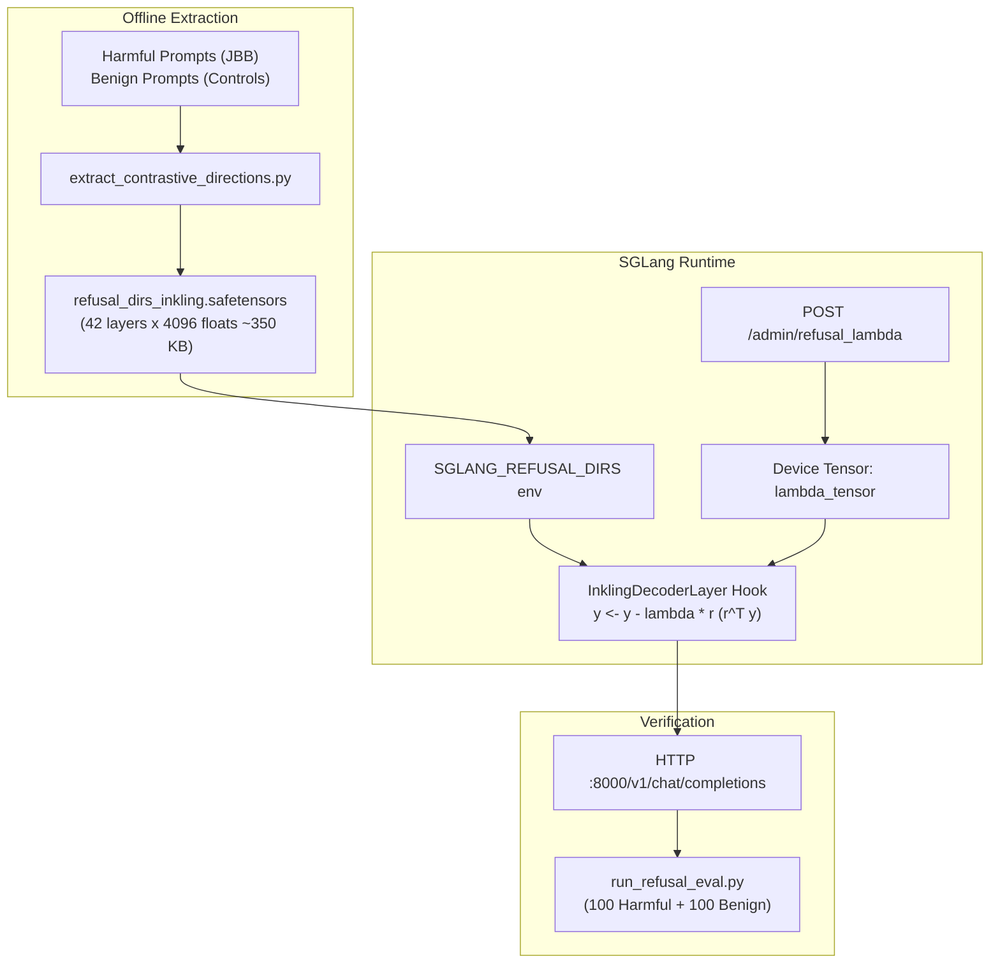

# Design Doc: Runtime Refusal Dial for Thinking Machines Inkling-Small NVFP4

- **Date**: 2026-11-10
- **Author**: Antigravity & Operator
- **Status**: Proposed
- **Target Model**: `thinkingmachines/Inkling-Small-NVFP4` (276B MoE / 12B active, 42 layers, 1M context)
- **Runtime**: SGLang + DSpark (`ghcr.io/drowzeys/inkling-sglang-gb10:kvquant`)
- **Cluster**: 2× DGX Spark (`gb10-spark` 10.10.20.10, `gx10-spark` 10.10.20.11), TP=2

---

## 1. Intent & The Why

In `sparkrun-recipes`, the runtime refusal dial pattern—first proven in [`qwen38-27b-nvfp4-refusal-dial.yaml`](file:///home/devops/workspace/sparkrun-recipes/recipes/qwen38-27b-nvfp4-refusal-dial.yaml) and [`deepseek-v4-flash-0731-refusal-dial-tp2.yaml`](file:///home/devops/workspace/sparkrun-recipes/recipes/deepseek-v4-flash-0731-refusal-dial-tp2.yaml)—demonstrated major advantages over traditional baked-weights abliteration:
1. **Preserves capability and eliminates quantization destruction**: Modifying weights directly in FP4 introduces severe quantization distortion and alters speculative decoding drafter alignment. Runtime rank-1 projection acts directly on hidden activations ($y \leftarrow y - \lambda \cdot \hat{r}(\hat{r}^T y)$) without touching quantized model weights.
2. **Bit-exact stock baseline**: At $\lambda=0.0$, the serving endpoint is byte-for-byte and mathematically identical to the official stock model.
3. **No duplicate multi-hundred gigabyte downloads**: Serving an abliterated model normally requires downloading an extra ~160 GB checkpoint. With runtime abliteration, the ablation is contained entirely within a ~350 KB `refusal_dirs.safetensors` file.
4. **Hot-switchable**: Safety behavior can be modulated live over HTTP (`POST /admin/refusal_lambda`) or per request without tearing down multi-gigabyte KV caches.

The goal of this project is to implement and verify this runtime refusal-dial mechanism for `thinkingmachines/Inkling-Small-NVFP4`.

---

## 2. Goals, Non-Goals & Anti-Goals

### Goals
- **Contrastive extraction tooling**: Create an automated extraction script (`benchmarks/redteam/extract_contrastive_directions.py`) to derive layer-wise rank-1 refusal directions ($\hat{r}_l$) across Inkling-Small's 42 transformer layers using contrastive prompt pairs (harmful vs. matched benign).
- **SGLang runtime refusal projection hook**: Inject a non-intrusive rank-1 projection hook into the Inkling model architecture in SGLang (`sglang/srt/models/inkling.py`), activated via environment variable `SGLANG_REFUSAL_DIRS`.
- **Mutable device lambda ($\lambda$)**: Maintain $\lambda$ as an in-place device tensor so SGLang CUDA graph captures (for batch sizes 1..16) and piecewise graph executions do not freeze or bake the dial value.
- **Admin HTTP endpoint**: Provide `POST /admin/refusal_lambda` (and `GET /admin/refusal_lambda`) in SGLang's web server to change $\lambda$ without restarting.
- **Sparkrun recipe**: Deliver `recipes/inkling-small-nvfp4-refusal-dial-tp2.yaml` inheriting the verified champion tunables (DSpark speculative decoding, `fp4_mx_block16` KV, 1M context).
- **Dual-split validation**: Measure and record compliance using [`benchmarks/redteam/run_refusal_eval.py`](file:///home/devops/workspace/sparkrun-recipes/benchmarks/redteam/run_refusal_eval.py) on both 100 harmful prompts and 100 matched benign controls, ensuring $\lambda=0$ exhibits expected stock refusal while $\lambda \ge 1.0$ achieves $\ge 95\%$ harmful compliance with $\ge 95\%$ benign compliance.

### Non-Goals
- **Weight modification**: No offline baking or re-quantization of model weights. The checkpoint files remain pristine and read-only.
- **Rewriting SGLang C++ / CUDA kernels**: The projection hook executes in PyTorch on the post-attention hidden states before residual addition / MLP normalization.
- **Cross-model generic extraction**: The immediate deliverable is calibrated specifically for Inkling-Small.

### Anti-Goals
- **Degrading DSpark speculative acceptance**: Refusal projection must not destabilize RadixArk DSpark draft verification. If draft acceptance drops measurably on unablated prompts, draft projection must be bypassed or decoupled (mode `off`).
- **Silently coming up ablated on cold boot**: The engine defaults to $\lambda=0.0$ at boot unless explicitly overridden by `SGLANG_REFUSAL_LAMBDA_INIT` in the recipe.
- **Exposing `/admin/refusal_lambda` to untrusted networks**: The admin endpoint has no authentication; documentation must mandate keeping the port internal.

---

## 3. Constraints

1. **Hardware & Topology**: 2× DGX Spark (`gb10-spark`, `gx10-spark`), each with 128 GB unified memory (121 GB allocatable). Inkling NVFP4 requires TP=2 over ConnectX-7 RoCEv2 (`10.99.10.10` / `10.99.11.11`).
2. **Current Cluster Workload**: The cluster is currently running `@spark-forge/qwen3.8-flash-next-abliterated-nvfp4-tp2`. Extraction or serving verification requires coordination (stopping existing workload when ready to launch Inkling).
3. **Weight Distribution**: The head node has all 10 shards (159 GiB) of `thinkingmachines/Inkling-Small-NVFP4` cached in `~/.cache/huggingface/hub/`. The worker node needs weight replication prior to TP=2 serving.
4. **SGLang Architecture**: Inkling runs on SGLang (`ghcr.io/drowzeys/inkling-sglang-gb10:kvquant`). SGLang uses breakable CUDA graphs (BCG), piecewise execution, and deferred short convolutions (`sconv`). The hook must execute cleanly across decode and prefill paths without violating graph invariants.

---

## 4. Approaches Considered

### Approach 1: SGLang-Native Refusal Hook + Contrastive Activation Extraction *(Selected)*
- **Architecture**:
  1. Contrastive extractor samples activations from Inkling-Small on harmful vs benign prompts, isolating $\mu_{\text{harmful}} - \mu_{\text{benign}}$ at each layer's attention output.
  2. A targeted patch/overlay to `/sgl-workspace/sglang/python/sglang/srt/models/inkling.py` adds `RefusalProjectionHook`.
  3. SGLang FastAPI server registers `/admin/refusal_lambda`.
- **Trade-offs**: Preserves champion throughput (~70 tok/s c=1 with DSpark, 1M context), minimal artifact footprint (~350 KB tensor), switchable on the fly.
- **Why chosen**: Directly meets the user's requirement for a runtime refusal dial without baking weights or losing DSpark performance.

### Approach 2: Port Inkling to vLLM
- **Architecture**: Move Inkling serving from SGLang to vLLM, which already contains `refusal_projection.py`.
- **Trade-offs**: Eliminates needing a new SGLang patch, but vLLM lacks the specialized MiaAI-Lab SM121 NVFP4 MoE kernels, DSpark block-7 draft implementation, and stable 1M context KV tuning for Inkling.
- **Why rejected**: vLLM performance on Inkling is unverified and significantly inferior to the tuned SGLang champion container.

### Approach 3: Offline Weight-Space Abliteration (Baked Weights)
- **Architecture**: Dequantize FP4 weights, subtract rank-1 component, and re-quantize.
- **Trade-offs**: Standard serving recipe, but destroys FP4 precision, creates an unnecessary 160 GB redundant checkpoint, and destroys draft acceptance.
- **Why rejected**: Violates user request for runtime abliteration and degrades model capability.

---

## 5. System Design & Component Details



### 5.1 Direction Extraction
- **Harness**: `benchmarks/redteam/extract_contrastive_directions.py`.
- **Dataset**: 32 representative harmful prompts selected from JailbreakBench (covering cyber, deception, harassment, CBRN, illegal acts) and 32 length-matched benign prompts.
- **Distributed Orchestration (Builder Call)**: Extraction runs via an instrumented SGLang serving instance launched in extraction mode (`--enable-activation-dump`) using sparkrun. This leverages SGLang's built-in multi-node RoCEv2 orchestration without needing a separate ad-hoc distributed MPI harness.
- **Token Boundary Slicing (Builder Call)**: Hidden states $h_{l, i}$ are captured at the **final token position of the prompt prefix** (index `-1` via `forward_batch.seq_lens`), isolating the exact state where refusal vs. compliance decision occurs, avoiding semantic dilution from topical or initial tokens.
- **Mathematical formulation**:
  For each layer $l \in [0, 41]$:
  $$\Delta \mu_l = \frac{1}{N_h} \sum_{i=1}^{N_h} h_{l, i}^{\text{harmful}} - \frac{1}{N_b} \sum_{j=1}^{N_b} h_{l, j}^{\text{benign}}$$
  $$\hat{r}_l = \frac{\Delta \mu_l}{\|\Delta \mu_l\|_2}$$
- **Serialization**: Saved as `refusal_dirs_inkling.safetensors` containing tensors `layers.{l}.r` of shape `[4096]`, dtype `float32`.

### 5.2 SGLang Model Patch (`recipes/mods/inkling-refusal-dial/`)
- **Hook class**: `InklingRefusalProjection`
  - Maintains `lambda_` device tensor (`torch.zeros(1, device='cuda', dtype=torch.float32)`).
  - Loads directions from `os.getenv("SGLANG_REFUSAL_DIRS")`.
  - **Hook Tap Point (Builder Call)**: Placed on the reduced hidden states after `mlp_norm` prior to MoE routing, or at the layer boundary on the full residual stream $[T, H]$. This avoids interfering with `ar_sconv_norm_fused`'s fused All-Reduce + `sconv` CUDA kernel while maintaining mathematical equivalence and full decode/speculative performance.
  - Projection op:
    ```python
    # hs: [num_tokens, hidden_size]
    # r: [hidden_size]
    dot = torch.matmul(hs, r)  # [num_tokens]
    hs = hs - self.lambda_ * torch.outer(dot, r)
    ```
- **CUDA Graph Safety**: Because `self.lambda_` is an in-place tensor buffer (mutated via `.fill_(val)`), its pointer remains fixed across CUDA graph capture and replay.
- **Step-Boundary Lambda Synchronization (Builder Call)**: $\lambda$ updates are received by the API server and communicated via SGLang's scheduler step context (`ForwardBatch`), ensuring rank 0 (`gb10-spark`) and rank 1 (`gx10-spark`) update synchronously at step boundaries without TP divergence.
- **RadixAttention Cache Invalidation (Builder Call)**: Any mutation of the global dial via `/admin/refusal_lambda` automatically triggers `tokenizer_manager.flush_cache()` to prevent cross-contamination of cached KV prefix states between $\lambda=0$ and $\lambda > 0$.

### 5.3 FastAPI Admin Route
- Added to SGLang API server (`sglang/srt/server.py` or middleware):
  - `GET /admin/refusal_lambda` -> `{"lambda": float(val)}`
  - `POST /admin/refusal_lambda` -> `{"status": "ok", "lambda": float(val)}` (triggers cache flush)

### 5.4 Recipe Specification: `recipes/inkling-small-nvfp4-refusal-dial-tp2.yaml`
Following the exact setup pattern established in [`recipes/qwen38-27b-nvfp4-refusal-dial.yaml`](file:///home/devops/workspace/sparkrun-recipes/recipes/qwen38-27b-nvfp4-refusal-dial.yaml):
- **Model**: `thinkingmachines/Inkling-Small-NVFP4` (stock weights)
- **Runtime**: `sglang` (TP=2)
- **Container**: `ghcr.io/drowzeys/inkling-sglang-gb10:kvquant` with the refusal projection overlay
- **Env**:
  ```yaml
  env:
    SGLANG_REFUSAL_DIRS: /opt/refusal/refusal_dirs_inkling.safetensors
    SGLANG_REFUSAL_LAMBDA_INIT: "1.0"
  ```
- **Pre-Exec** (verifies directions load and claim all 42 layers before engine boot):
  ```yaml
  pre_exec:
    - python3 /opt/refusal/verify_inkling_rank1.py
  ```
- **Post-Exec** (confirms readiness, sets default lambda=1.0 uncensored, prints active state):
  ```yaml
  post_exec:
    - curl -s localhost:{port}/v1/models
    - 'curl -s -XPOST localhost:{port}/admin/refusal_lambda -H ''Content-Type: application/json'' -d ''{{"lambda": 1}}'''
    - curl -s localhost:{port}/admin/refusal_lambda
  ```
- **Post-Commands** (prints standard operator helper commands):
  ```yaml
  post_commands:
    - 'echo "ablation on:  curl -XPOST {head_host}:{port}/admin/refusal_lambda -d ''{{\"lambda\": 1}}''"'
    - 'echo "ablation off: curl -XPOST {head_host}:{port}/admin/refusal_lambda -d ''{{\"lambda\": 0}}''"'
  ```

---

## 6. What's Left to the Builder

The builder has full discretion over:
1. **Mod injection method**: Whether to inject the SGLang patch via a `PYTHONPATH` overlay mod directory in `recipes/mods/` (recommended, clean) or building a derived local Docker image tag (`spark-forge/inkling-sglang-rank1:latest`).
2. **Batching during activation extraction**: Number of prompts per batch (1 vs 4) during the extraction phase to fit inside available VRAM comfortably.
3. **Draft projection**: By default, DSpark draft layers are not projected unless eval indicates speculative divergence.
4. **Exact refusal trigger prompt selection**: The builder may draw from the existing `benchmarks/redteam/` JBB datasets.

---

## 7. Operational & Verification Plan

1. **Pre-flight**:
   - Verify cluster idle state (`rtk sparkrun status`).
   - Sync Inkling shards from head to worker: `rsync -avP ~/.cache/huggingface/hub/models--thinkingmachines--Inkling-Small-NVFP4/ devops@10.10.20.11:~/.cache/huggingface/hub/models--thinkingmachines--Inkling-Small-NVFP4/`.
2. **Extraction**:
   - Run extraction script to produce `refusal_dirs_inkling.safetensors`.
   - Verify tensor sanity (norms $= 1.0$, correct shapes, no NaNs).
3. **Launch & Admin Verification**:
   - `sparkrun run recipes/inkling-small-nvfp4-refusal-dial-tp2.yaml`.
   - Test toggle: `curl -XPOST localhost:8000/admin/refusal_lambda -d '{"lambda": 0}'` and `curl -XPOST localhost:8000/admin/refusal_lambda -d '{"lambda": 1.0}'`.
4. **Evaluation**:
   - Run `benchmarks/redteam/run_refusal_eval.py --base http://127.0.0.1:8000/v1 --model inkling-small --split both --out results_inkling_dial.jsonl`.
   - Confirm compliance at $\lambda=1.0$ and refusal at $\lambda=0.0$.
